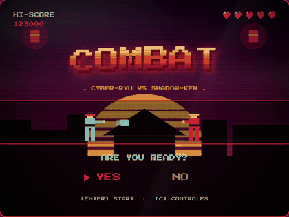
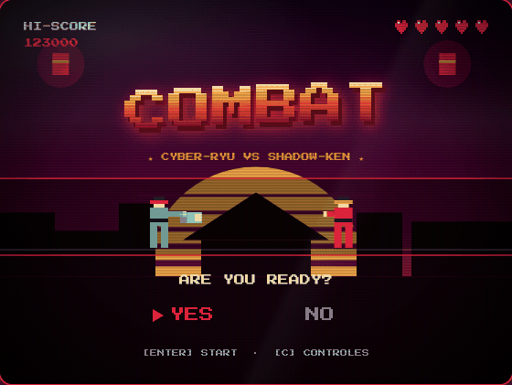
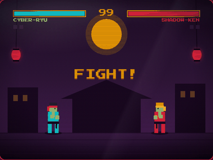
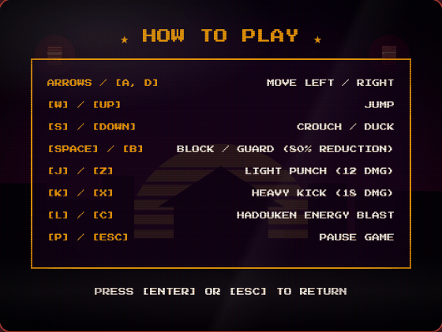
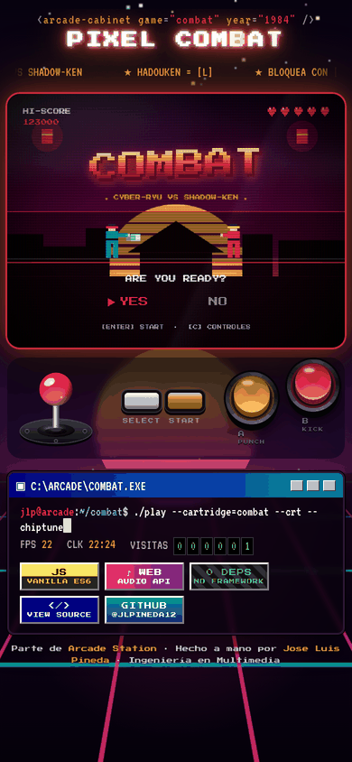

<div align="center">

<a href="https://jlpineda12.github.io/pixel-combat-arcade/"></a>

# 🥊 PIXEL COMBAT · 1984

**Pelea 1v1 retro: CYBER-RYU contra SHADOW-KEN, una CPU que reacciona a lo que haces.**

[](https://jlpineda12.github.io/pixel-combat-arcade/)
[](https://jlpineda12.github.io/arcade-station/)

[](https://github.com/Jlpineda12/pixel-combat-arcade/actions/workflows/deploy.yml)


</div>

---

## 📺 Así se ve

| Menú animado | Partida |
| :---: | :---: |
|  |  |
| **Guía de controles** | **En el celular** |
|  |  |

La pantalla CRT flota sobre un escenario *synthwave* animado, con secuencia de arranque tipo BIOS, marquesina de neón y una barra de estado estilo terminal de los 90.

## 🕹️ Controles

| Teclado | Panel táctil (móvil) | Acción |
| :--- | :--- | :--- |
| `A / D` | Joystick ← → | Moverse |
| `W` | Joystick ↑ | Saltar |
| `S` | Joystick ↓ | Agacharse |
| `J / Z` | A (PUNCH) | Puño (12 de daño) |
| `K / X` | B (KICK) | Patada (18 de daño) |
| `L` | — | Hadouken (proyectil) |
| `Space` | — | Bloquear (−80% de daño) |
| `P / Esc` | — | Pausa |

> En el celular aparece debajo de la pantalla un joystick y botones táctiles; en escritorio se usa el teclado.

## ✨ Características

- **Sistema de combate real**: hitboxes / hurtboxes, guardia, agacharse y proyectil especial con enfriamiento.
- **Hit-stop y sacudida** en los golpes fuertes para que cada impacto se sienta.
- **CPU con IA reactiva** que se acerca, bloquea y contraataca.
- **Rondas al mejor de 3** con reloj de 99 segundos, banners de ROUND / FIGHT / K.O.
- **Banda sonora de batalla a 144 BPM** y efectos generados con Web Audio API.

## 📊 Resultados

| Métrica | Resultado |
| :--- | :--- |
| Pruebas automatizadas (`npm test`) | ✅ **26 / 26** pasan en cada despliegue |
| Archivos de audio / imagen | **0** — todo se genera con código |
| Dependencias de npm | **0** — JavaScript puro (ES modules) |
| Rendimiento | **60 FPS** estables en Canvas 2D |
| Responsivo | Escritorio y móvil (panel táctil) |

## 🏛️ Estructura del proyecto

```
pixel-combat-arcade/
├── index.html                # Página: marquesina, pantalla CRT, panel y barra de estado
├── src/
│   ├── main.js               # Arranque: audio, juego, shell y bucle a 60 FPS
│   ├── game/
│   │   ├── Game.js           # Máquina de estados (menú, partida, pausa, game over)
│   │   ├── MenuFX.js         # Menú animado: fondo temático, título en onda, attract mode
│       ├── Fighter.js      # Estados, animación y hitboxes del luchador
│       ├── AI.js           # Comportamiento de la CPU
│       ├── Projectile.js   # Hadouken
│       ├── Stage.js        # Escenario del dojo
│       ├── Particles.js    # Chispas de impacto
│   ├── audio/
│   │   ├── SynthEngine.js    # Osciladores, envolventes y ruido (Web Audio API)
│   │   ├── SoundEffects.js   # Efectos de sonido procedurales
│   │   └── BattleMusic.js   # Música chiptune generada en tiempo real
│   └── shell/
│       ├── RetroShell.js     # Presentación: arranque BIOS, CRT, panel táctil, terminal
│       └── shell.css         # Sistema visual synthwave / CRT compartido
├── test/qa-runner.js         # Suite de pruebas sin dependencias
├── docs/screenshots/         # Capturas y GIFs de este README
└── .github/workflows/        # Pruebas + despliegue automático a GitHub Pages
```

## 🚀 Ejecutar en local

No necesita instalar nada. Sirve la carpeta con cualquier servidor estático:

```bash
python3 -m http.server 8080
```

y abre `http://localhost:8080`. Para correr las pruebas:

```bash
npm test
```

## 👤 Autor

**Jose Luis Pineda Barrera** · [@Jlpineda12](https://github.com/Jlpineda12) · Ingeniería en Multimedia, Colombia 🇨🇴

Este juego también vive dentro de **[Arcade Station](https://github.com/Jlpineda12/arcade-station)**, el gabinete que reúne los 5 juegos.
